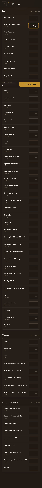
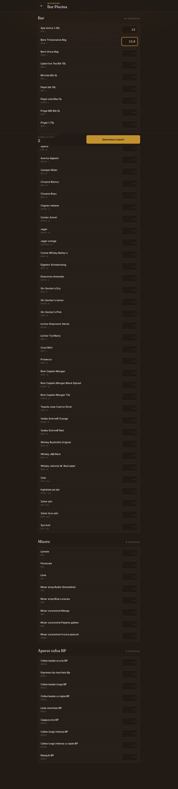

# 📂 Portfolio — Nicolae Cristian Lapușneanu

**AI-Native Software Engineer · Full-Stack Developer (Next.js / Python)**

I turn ideas into real, working products — fast. Below are selected projects, built end-to-end.
Some are commercial or in active development, so their source code is private; this page shows
what they do, the stack, and how they're built.

📫 [LinkedIn](https://www.linkedin.com/in/nicolae-lapusneanu/) · niculapusneanu1@gmail.com

---

## 🏆 Bar Inventory — Savoy Hotel Complex (Mamaia)
**Commercial product · in production · used daily by the hotel's staff**

A web app I designed, built and shipped for a real client. It replaced slow manual inventory
with a fast, mobile-first flow the staff now uses every day on the floor, plus a desktop
dashboard for management.

- **Full ownership, end-to-end:** UI, backend, auth, security, deployment
- **Real integration:** Excel/CSV export compatible with the client's **ExpressSoft POS**
- **Reliability:** JWT auth, security hardening (Helmet, rate-limiting), automated tests (Jest)
- **Delivery:** shipped a lean MVP, then iterated from real operational feedback (130+ commits)

**Stack:** React · Vite · Tailwind CSS · Node.js · Express · Prisma · PostgreSQL

| Mobile (on-site inventory) | Desktop dashboard |
|---|---|
|  |  |

> 🔒 Source code private (client project). Available for review on request.

---

## 🤖 Logion — SaaS platform with an agentic AI assistant
**My own initiative · 2026**

A multi-tenant accounting platform where I built an **agentic AI assistant** ("Senior Accountant")
and an **OCR document-processing pipeline** — orchestrating LLM calls into a reliable,
step-by-step workflow.

- Agentic assistant + OCR pipeline (LLM orchestration)
- Multi-tenant architecture, JWT auth, role-based access (5 roles)
- KPI dashboard, e-Invoice (ANAF) integration

**Stack:** Next.js · TypeScript · Python · PostgreSQL

> 🔒 Source code private. Available for review on request.

---

## 🍽️ StocSoft — stock & food-cost automation for restaurants
**My own initiative · 2026**

A multi-tenant SaaS that automates restaurant stock control: it ingests POS sales, breaks them
down by recipe and deducts stock automatically, showing real vs. theoretical food cost.

- Automated pipeline from POS sales → recipe breakdown → stock deduction
- Async workers (BullMQ + Redis) for invoice parsing & sales import
- Multi-tenant isolation via Row-Level Security

**Stack:** React · Node.js · Express · PostgreSQL · Prisma · Redis · TypeScript

> 🔒 Source code private. Available for review on request.

---

## 🌐 Other projects
- **ControMed** — medical services website, live on Vercel · *(public repo)*
- **ContaCore** — accounting web app · Next.js
- **Medix** — medical website · Wix Velo + JavaScript

---

## 🛠️ Core skills
**AI:** LLM integration (Gemini, GPT, Claude APIs), prompt engineering, agentic workflows, OCR ·
AI-assisted dev (Claude Code, Codex)
**Full-stack:** Next.js, React, TypeScript, Node.js, Tailwind, Vite
**Backend:** Python, FastAPI, Express, REST APIs, PostgreSQL, Prisma, Redis
**Tools:** Git, Linux, Jest, Vercel/VPS deployment
